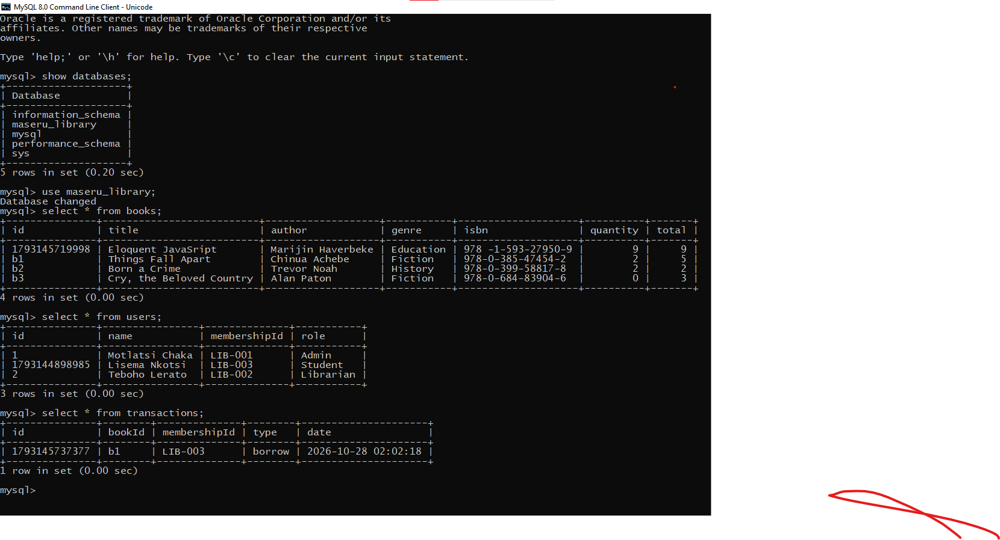
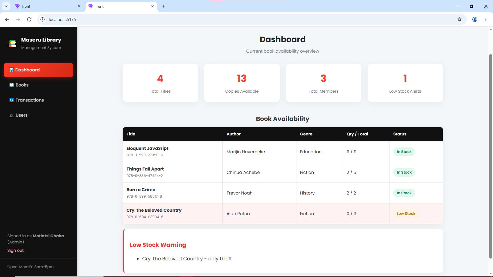
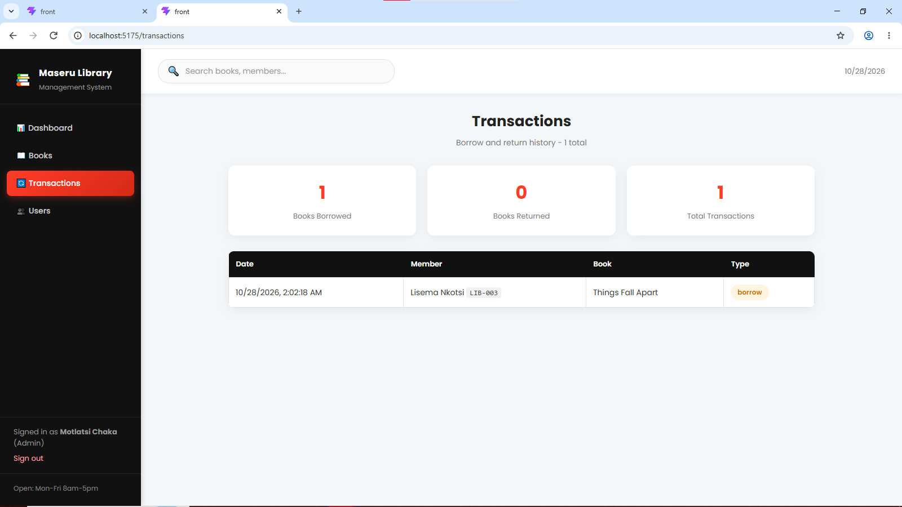

# Maseru District Library Management System
Assignment 4 - React + Express + MySQL

## Student: [MOTLATSI CHAKA 901020598]
## Tech Stack
- Frontend: React (Hooks, Router, Fetch API), CSS
- Backend: Express.js REST API
- Database: MySQL 8.0
- Tools: MySQL Command Line Client

## Features Implemented (As per Brief)

### 1. Book Management (CRUD)
- Add new books: Title, Author, Genre, ISBN, Initial Quantity
- Update existing book details
- Delete books
- Validation with controlled forms

### 2. Availability Management
- Track quantity of each book in stock (quantity / total)
- Borrow = deduct stock, Return = add stock
- Low stock highlight (< 2 copies) on Dashboard
- Transaction history log

### 3. User Management
- Login with Membership ID
- Add / Update / Delete users (name, membershipId, role: Student/Librarian/Admin)
- Roles stored in MySQL

### 4. UI Pages
- `/` Dashboard - Book availability table, low stock warning, stats
- `/books` Book Management - Add form + editable grid with Update/Delete/Borrow/Return
- `/transactions` Transactions Page - Stock add/deduct + history
- `/users` User Management - Admin CRUD
- Responsive + consistent theme

## Project Structure

## How to Run

### Prerequisites
- Node.js, MySQL running
- MySQL password: Chaka@1234 (update in backend/db.js if different)

### 1. Backend
```bash
cd backend
npm install
node server.js
# Runs on http://localhost:5000
# Creates database maseru_library automatically if not exists
### 2. Frontend
cd frontend
npm install
npm run dev
# Runs on http://localhost:5173

### 3.Database Varification


### 4. Dadhboard with low stock



### 5. Borrow/Returning Working



